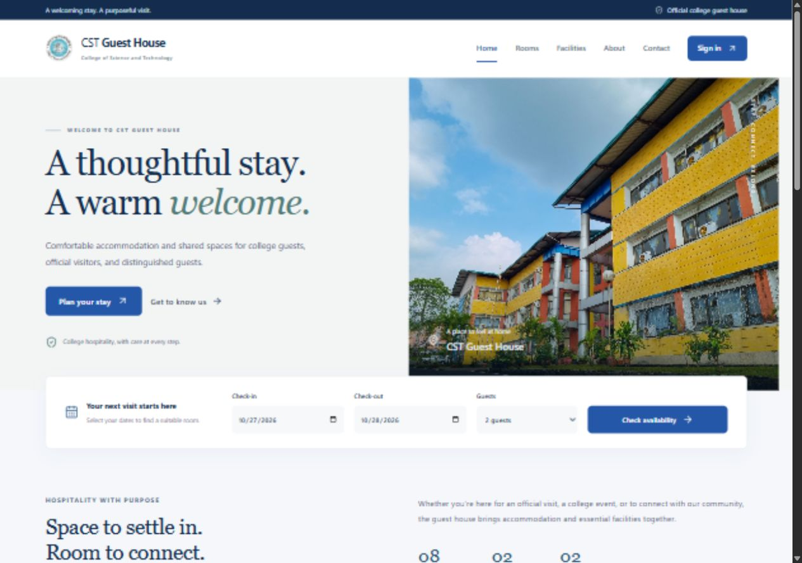
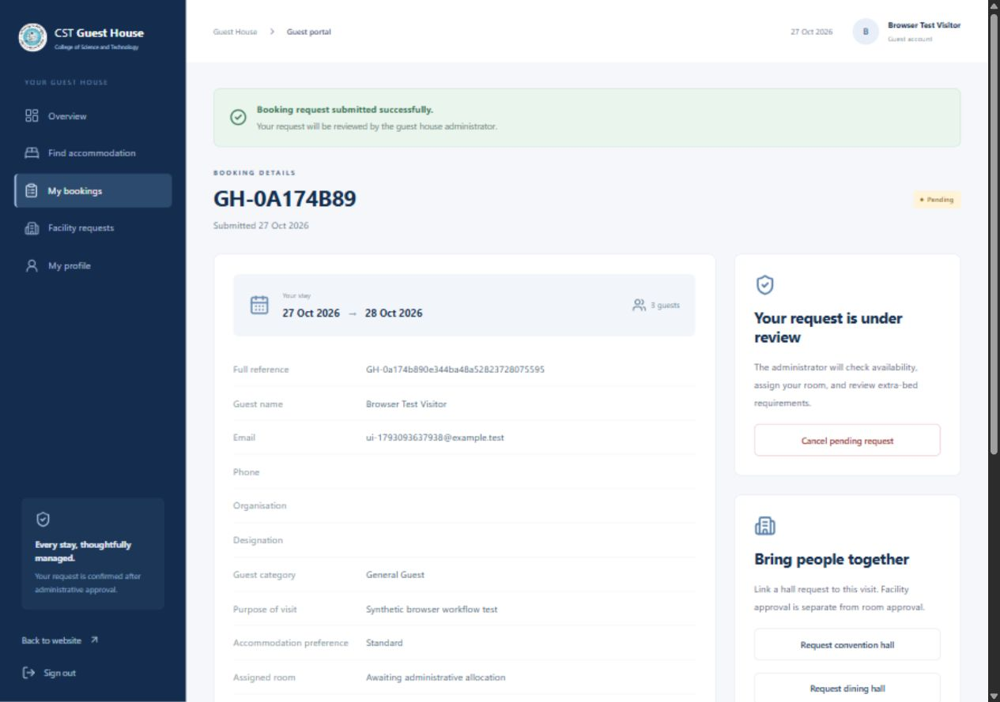
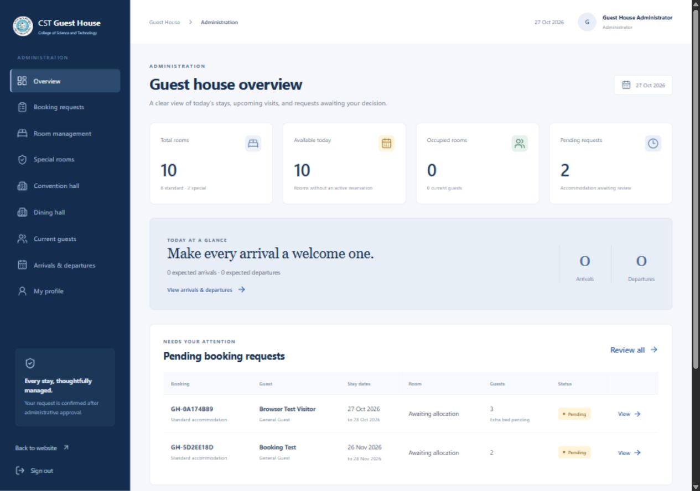

# CST Guest House Management System

A booking and operations portal for the College of Science and Technology Guest House in Rinchendhing, Bhutan. Guests can check availability and request a stay or facility. Staff can review requests, manage rooms, and track arrivals and departures from the same system.

[Features](#features) · [Quick start](#quick-start) · [Testing and CI](#testing-and-ci) · [Team workflow](#team-workflow)



## Features

| Guests | Administrators |
| --- | --- |
| Register, sign in, and manage a profile | Review, approve, or reject booking requests |
| Search rooms by dates and guest count | Manage room allocation, extra beds, and room details |
| Request accommodation and follow its status | Record check-in and check-out |
| Request dining or convention facilities | Manage facility schedules, user access, and operational reports |

A pending accommodation request holds a specific room for the requested dates. Other guests cannot book that room for overlapping dates. Approval retains the hold, while rejection or cancellation releases it. PostgreSQL enforces the overlap rule even when requests arrive concurrently.

| Booking confirmation | Administrator dashboard |
| --- | --- |
|  |  |

## Quick start

For local development on Windows, install **Java 21**, **Node.js 24 LTS** (see [the pinned version](frontend/.nvmrc)), and **Docker Desktop** with Docker Compose. Open Docker Desktop before starting the app.

From the repository root in PowerShell:

```powershell
Copy-Item .env.example .env
```

Edit `.env` and set a local database password, a JWT secret, and your initial administrator email and password. If you change the database user, database name, or port, keep `DATABASE_URL` consistent. Keep `.env` out of Git.

```powershell
npm --prefix frontend ci
.\start-local.ps1
```

| Service | Address |
| --- | --- |
| Website | [127.0.0.1:5173](http://127.0.0.1:5173/) |
| Backend health | [127.0.0.1:8080/actuator/health](http://127.0.0.1:8080/actuator/health) |

The startup script starts PostgreSQL in Docker and launches the backend and frontend locally. Flyway applies the database migrations. Sign in as an administrator using the credentials you configured. If startup fails, check the backend and frontend logs in `.logs/`.

## Project structure

| Path | Purpose |
| --- | --- |
| [frontend/](frontend/) | React and TypeScript interface, built with Vite |
| [backend/](backend/) | Spring Boot API, Spring Security, PostgreSQL migrations, and Java tests |
| [CST-GuestHouse/](CST-GuestHouse/) | Original HTML prototype |
| [postman/](postman/) | API requests and local environment template |
| [.github/workflows/](.github/workflows/) | GitHub Actions for CI and manual deployment |
| [docs/](docs/) | Architecture, workflows, and operating guides |

## Testing and CI

Run the frontend tests and build from the project root:

```powershell
npm --prefix frontend test
npm --prefix frontend run build
```

Run the Java tests and the PostgreSQL integration suite:

```powershell
Push-Location backend
.\mvnw.cmd verify
Pop-Location
.\backend\run-integration-tests.ps1
```

[Build and verify guest house](.github/workflows/ci.yml) runs on pull requests and pushes to `main` or `develop`. The Java and PostgreSQL tests run in parallel with the frontend tests, build, and dependency audit. The Docker image builds start after both jobs pass. Deployment uses a [separate, manually triggered workflow](.github/workflows/deploy.yml) and requires a configured server.

## Team workflow

| Member | Integration branch |
| --- | --- |
| Sherab Dorji | `guesthouse/sherabdorji10` |
| Kinley Phuntsho | `guesthouse/boogey05` |
| Chimi Gyeltshen | `guesthouse/chigyel` |
| Karma Sonam | `guesthouse/karma-sonam` |
| Pasang Gyeltshen | `guesthouse/gyaltshay` |
| Sonam Choejur | `guesthouse/sonam11012` |

Each member adds their assigned batch at its original paths, pushes from their own account, and opens a pull request into `main`. Describe what you integrated and how you verified it. For the initial assembly, merge the workflow batch last, then check the first Actions run on `main`. When staging the Maven wrapper from a Windows upload batch, use `git update-index --chmod=+x backend/mvnw` to preserve its executable bit.

The integration batches were prepared from working snapshot `440185e`. The original implementation and its authorship are recorded in the [source repository](https://github.com/Karma-Sonam/cst-guest-house/commit/440185eae40c6db60bdde9dbdf22a80a5985453b).

## Further reading

- [Architecture and implementation blueprint](docs/implementation-blueprint.md)
- [Pending room holds and live data](docs/pending-holds-and-live-data.md)
- [Facility booking API](docs/facility-backend.md)
- [Local backup and restore](docs/local-backups.md)
- [Delivery and deployment](docs/delivery.md)

